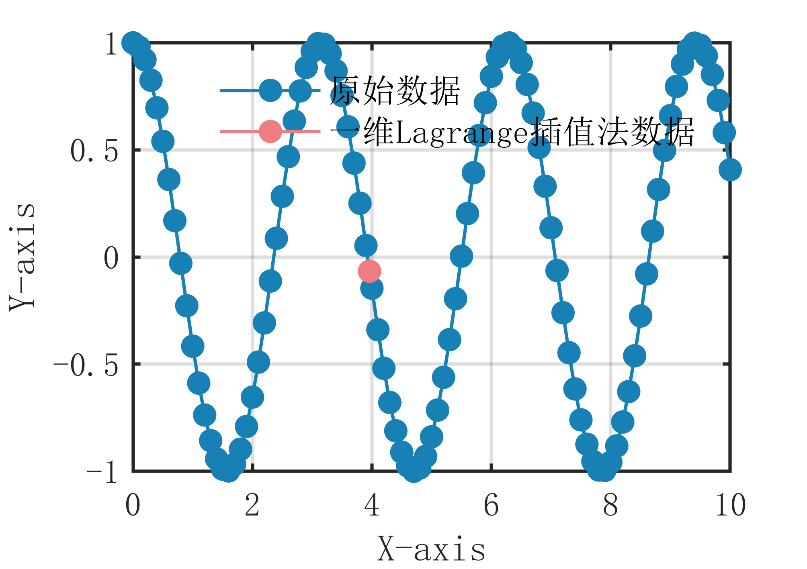

# MATLAB | Interpolation Algorithm | One-Dimensional Lagrange Interpolation Method | Included data and plotting code | Directly Useable

1. Basic Definition of One-Dimensional Lagrange Interpolation Algorithm
The principle of the one-dimensional Lagrange interpolation algorithm is to construct a polynomial function of degree n-1 based on known data points, and then calculate the function value at any point by interpolating through these known points. The specific algorithm steps are as follows:
Input a set of known discrete data points, where  is the independent variable and  is the dependent variable.
Construct a polynomial function of degree n-1 that satisfies the function values at all known data points.
Use the Lagrange interpolation formula to calculate the function value of the interpolated point . The specific formula is given by .
Output the function value of the interpolated point . The core idea of the one-dimensional Lagrange interpolation algorithm is to fit a polynomial function to the known data points to obtain the function value of an unknown point. Compared to linear interpolation algorithms, it can fit more complex curves, but when there are many data points, its computational complexity is high, and it may also suffer from Runge phenomenon leading to reduced interpolation accuracy. Therefore, in practical applications, it is necessary to choose an appropriate interpolation method according to specific circumstances.
2. Definition and Graphing Outcome
The graphing outcome is as follows:
\n        \n      Attach video tutorial for operation:
\n        \n          \n          \n          \n          \n            To view this video please enable JavaScript, and consider upgrading to a\n            web browser that\n            supports HTML5 video\n

## Images

<!-- PAYMENT_BLOCK -->

## Get this dataset

- Payment link (Stripe): [Buy now](https://buy.stripe.com/3cs8yP7sY87d0vu9AB)
- Payment QR code: 

<!-- /PAYMENT_BLOCK -->
